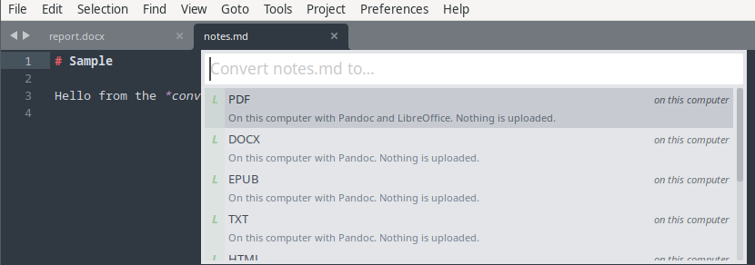

# Converter Studio for Sublime Text

Convert files from the Command Palette: Markdown to PDF or Word, Word to PDF, videos to MP4 or MP3,
pictures to WebP, CSV to JSON, scans to text. Conversions run **on your computer** with tools you
already have. The [Converter Studio](https://converter.studio) desktop app and cloud are there when
you choose them.



## Where your files go

Every format in the list is marked with where it runs. Nothing runs in the cloud unless you pick it.

| Mark | Where it runs                                                 | What leaves your computer                                                                                                                       |
| ---- | ------------------------------------------------------------- | ----------------------------------------------------------------------------------------------------------------------------------------------- |
| L    | On this computer, with tools installed here (list below)      | Nothing is uploaded.                                                                                                                            |
| D    | The Converter Studio desktop app, on this computer (opt-in)   | Nothing is uploaded. Sublime Text opens a `converter-studio://` link with the file's path, and the app converts it here.                        |
| C    | The Converter Studio cloud, only when you pick a cloud format | The file is uploaded to converter.studio over HTTPS, converted, and deleted (the upload right away, the result after 6 hours). It uses credits. |

The package sends nothing anywhere on its own: no telemetry, no update checks, no list downloads
(the list of formats is built in). It talks to converter.studio only when you pick a cloud
conversion, press **Try in the Cloud** after a local conversion failed, or run **Show Plan and
Credits**. Those requests carry your API key and name this package and its version. Read the
[privacy policy](https://converter.studio/privacy).

## Install

In Sublime Text, run **Package Control: Install Package** and choose **Converter Studio**.
Requires Sublime Text 4 (build 4107 or later) on Windows, macOS or Linux.

## Use

| Command                                         | What it does                                                     |
| ----------------------------------------------- | ---------------------------------------------------------------- |
| Converter Studio: Convert Current File…         | Converts the file you are editing (asks to save unsaved changes) |
| Converter Studio: Convert File…                 | Asks for one or more files, then converts them                   |
| Converter Studio: Cancel Conversion             | Stops the running conversion; nothing is saved                   |
| Converter Studio: Show Local Tools              | Lists the tools found on this computer and what they convert     |
| Converter Studio: Show Plan and Credits (Cloud) | Shows your Converter Studio plan and credits (uses your key)     |
| Preferences: Converter Studio Settings          | Opens the default settings and yours side by side                |

Pick a format and the result is saved next to the original. An existing file is never
overwritten: `report.pdf` is taken, so the result becomes `report (2).pdf`. Progress shows in the
status bar. If a local conversion fails, you see the tool's message and can choose **Try in the
Cloud (Uses Credits)**; the cloud is never used without that click.

## What converts on this computer

The tools are found on `PATH` and in their usual install folders (Homebrew, winget, Chocolatey,
Scoop, Program Files). If one is somewhere else, set its path in `tool_paths`. What each tool can
do is asked from the tool itself: an FFmpeg without libx264 offers no MP4, an ImageMagick without
HEIC support offers no HEIC.

| Tool                                                                   | Conversions                                                                                 |
| ---------------------------------------------------------------------- | ------------------------------------------------------------------------------------------- |
| Built in (Python)                                                      | CSV ↔ JSON; SRT ↔ VTT; ASS → SRT, VTT                                                       |
| [LibreOffice](https://www.libreoffice.org/download/)                   | Word, Excel, PowerPoint, OpenDocument, RTF, TXT, HTML, CSV → PDF and to each other; → EPUB  |
| [Pandoc](https://pandoc.org/installing.html)                           | Markdown, HTML, Word, OpenDocument, EPUB, RTF → Markdown, HTML, Word, ODT, EPUB, RTF, TXT   |
| Pandoc and LibreOffice together                                        | Markdown and EPUB → PDF (no LaTeX needed)                                                   |
| [FFmpeg](https://ffmpeg.org/download.html)                             | Video → MP4, WebM, MOV, MKV, GIF, and to audio; audio → MP3, M4A, WAV, FLAC, OGG, Opus, AAC |
| [ImageMagick](https://imagemagick.org/script/download.php)             | JPG, PNG, WebP, AVIF, HEIC, GIF, BMP, TIFF, ICO, camera RAW → JPG, PNG, WebP, AVIF, PDF…    |
| [Ghostscript](https://ghostscript.com/releases/gsdnld.html)            | PDF → a smaller PDF; PDF pages → PNG or JPG                                                 |
| [Tesseract](https://tesseract-ocr.github.io/tessdoc/Installation.html) | Pictures → text, or a searchable PDF (text recognition, in the `ocr_language` you set)      |

These are simple, public recipes (see `converterstudio/recipes.py`). The quality is that of your
tools and their defaults.

## The desktop app (optional)

With [Converter Studio for desktop](https://converter.studio/download) version 0.1.11 or later
installed, set `"use_desktop_app": true`. The list then also offers the desktop app's formats
(marked D). Picking one hands the files over: the app shows a card "Files from Sublime Text";
press Continue, check the format, and press Convert. Nothing converts until you do. Older versions
of the app only come to the front.

- Only files on this computer's own disk are handed over, not files on network shares or remote
  mounts.
- The Snap and Flatpak builds of the desktop app can only open files in your home folder.

## The cloud (optional)

The cloud converts everything Converter Studio converts (more than 60 formats, including RAW
photos, e-books and fonts). In the list, choose **More formats in the cloud…**, or set
`"list_cloud_formats": true` to see every cloud format in the main list.

1. Make a free account at [converter.studio](https://converter.studio) and create an API key on
   your [account page](https://converter.studio/account#api-keys).
2. Put the key in your settings as `"api_key"`. **It is stored in plain text in your settings
   file.** If you sync or share your `Packages/User` folder, leave `api_key` empty and set the
   environment variable `CONVERTER_STUDIO_API_KEY` instead (on macOS, Sublime Text started from the
   Dock does not see variables set in your shell profile; use `launchctl setenv` or start it with
   `subl` from a terminal).

Each cloud conversion uses credits of your account: most pictures and documents cost 1 credit;
video and audio cost more depending on their length. A free account gets free credits every day;
[paid plans](https://converter.studio/pricing) have more credits and larger files. A conversion
that costs more than `max_credits` (20) asks first. A failed conversion costs nothing. Cancel stops
the package at once; a conversion already started at Converter Studio may still finish there.

## Settings

| Setting              | Default                        | What it does                                                                |
| -------------------- | ------------------------------ | --------------------------------------------------------------------------- |
| `tool_paths`         | empty (look for them)          | The path of `ffmpeg`, `soffice`, `pandoc`, `magick`, `gs`, `tesseract`      |
| `timeout_seconds`    | `600`                          | A local conversion that takes longer is stopped                             |
| `ocr_language`       | `"eng"`                        | Tesseract's language (`"deu"`, `"tur"`, `"eng+deu"`…); it must be installed |
| `use_desktop_app`    | `false`                        | Offer the Converter Studio desktop app                                      |
| `list_cloud_formats` | `false`                        | List every cloud format in the main list                                    |
| `api_key`            | empty                          | Your API key (plain text; or use `CONVERTER_STUDIO_API_KEY`)                |
| `api_url`            | `https://converter.studio/api` | Only for a test server (https, or http on this computer)                    |
| `max_credits`        | `20`                           | A cloud conversion that costs more asks first (`0`: always ask)             |

## Key bindings

The package adds no key bindings. To convert the current file to a format with one key press, add a
binding to your own key bindings (**Preferences: Key Bindings**):

```json
[
  {
    "keys": ["ctrl+alt+p"],
    "command": "converter_studio_convert_current_file",
    "args": { "to": "pdf" }
  }
]
```

`to` is a format id (`pdf`, `docx`, `md`, `mp4`, `mp3`, `webp`, `jpg`, `json`…). Add
`"where": "cloud"` or `"where": "desktop"` to convert there instead of on this computer; without a
matching local tool, the format list opens.

## Limits

- One conversion runs at a time.
- Local results depend on the tools and versions you have; the package does not install them.
- Word files converted to Markdown lose their pictures (Pandoc does not extract them here).
- The cloud takes one file and returns one file (a multi-page PDF to pictures comes back as a ZIP).

## Support

Questions and bug reports: [GitHub issues](https://github.com/tariksucu/sublime-converter-studio/issues)
or support@converter.studio. The cloud API is documented at
[converter.studio/developers](https://converter.studio/developers).

## License

[MIT](LICENSE), © Converter Studio.
